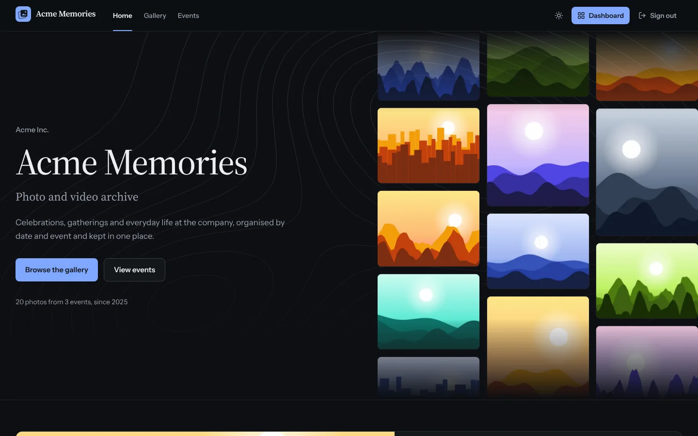
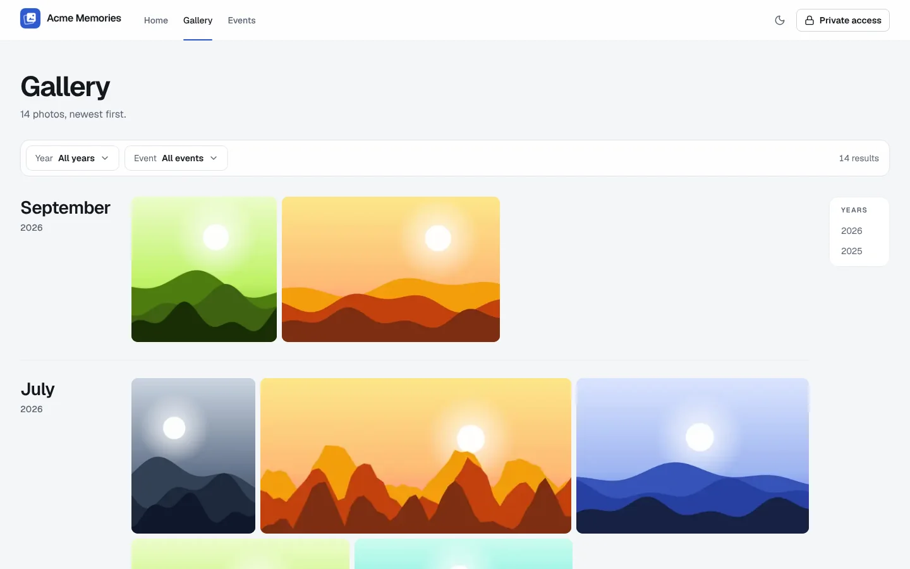
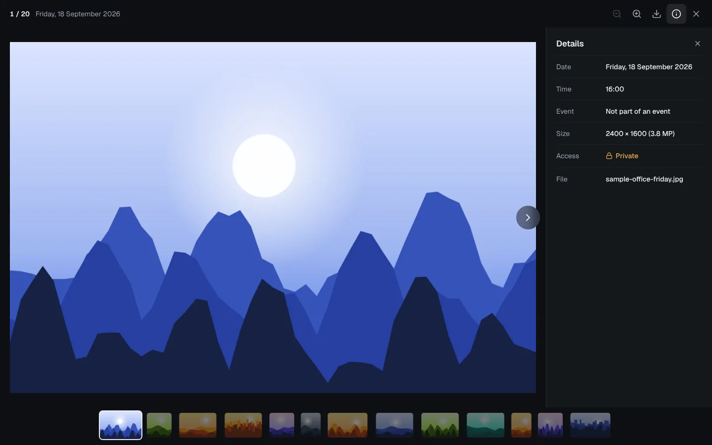
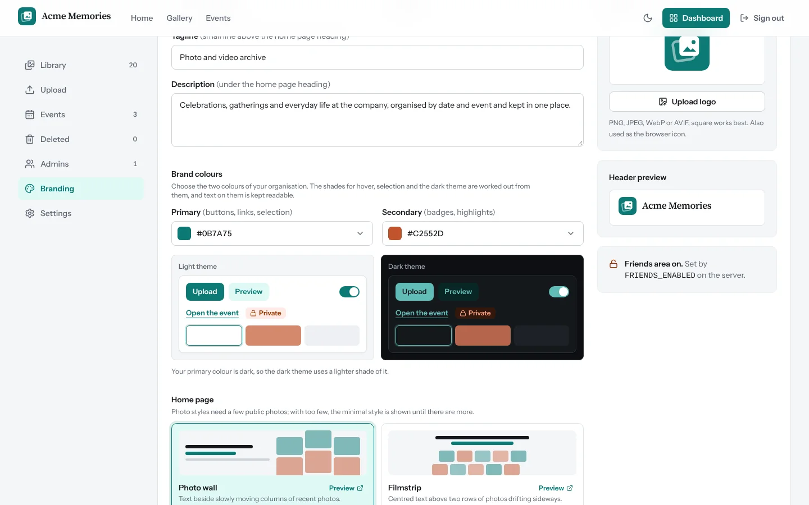
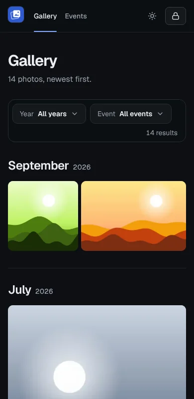

# Memory

**A private photo and video archive your organisation runs on its own server.**

Company events, gatherings and everyday moments, organised by date and by event, behind your own domain. One
Node.js process, no database to install, and your name, logo and colours on every page.

_Memory (یادگار) is Persian for a keepsake._



| Gallery by month                                | Viewer with details                             |
| ----------------------------------------------- | ----------------------------------------------- |
|  |  |
| **Brand colours with a preview of both themes** | **Works from a 360px phone upwards**            |
|      |            |

## What you get

**For visitors**

- A home page that opens in one of seven styles, the latest event, the newest photos and all events.
- A gallery with a month-by-month timeline and filters for year, event and type.
- A full-screen viewer with zoom, swipe, keyboard keys, a filmstrip and a details panel.
- A light and a dark theme, remembered per browser.

**For the team**

- Public and private items. Friends of the team see the private ones with one shared passcode (optional),
  admins sign in.
- A dashboard to upload, organise, move between events and delete, with multi-select.
- Deleting is reversible: what an admin deletes waits for the super admin, who restores or removes it.
- Photos: JPEG, PNG, HEIC, WebP, AVIF, GIF, TIFF. Videos: MP4, MOV, WebM, MKV, AVI, WMV and more, converted on
  the server to an MP4 that plays in every browser.

**For your organisation**

- **Your brand, without touching code.** Name, logo, texts and two brand colours are set in the dashboard.
  Hover, selection and dark-theme shades are derived from your colours, and text on them is kept readable
  (WCAG AA).
- **Your server, your data.** Everything lives in one folder you can back up with `rsync`. Nothing is loaded
  from other sites, not even fonts.
- **Small to run.** One process, port 3000, no database server, no queue, no cache.

## Quick start

### Docker

```bash
git clone https://github.com/<your-username>/memory.git
cd memory
docker compose up -d
docker compose logs memory | grep '\[setup\]'
```

Open <http://localhost:3000/setup>, enter the setup code from the log, then choose the archive name and the
first account. Photos and accounts are kept in the `memory-data` volume.

### Node.js

Needs Node.js 20.9 or newer.

```bash
npm install
npm run build
npm start
```

For development use `npm run dev`. To try it with content, `npm run samples` adds about twenty generated
photos in three events (`npm run samples -- --remove` takes them out again).

## Make it yours

Sign in as the super admin and open **Dashboard › Branding**:

| Setting       | What it changes                                                                  |
| ------------- | -------------------------------------------------------------------------------- |
| Name, texts   | Header, browser tab, home page heading, footer.                                  |
| Logo          | Header, sign-in pages and the browser icon. Re-encoded as a plain PNG on upload. |
| Brand colours | Buttons, links, selection, badges and focus rings, in both themes.               |
| Home page     | One of seven opening styles, each with a private preview before you save.        |

The same values can be given as environment variables (`SITE_NAME`, `BRAND_PRIMARY_COLOR`, …) when one image
is deployed for several organisations. See [.env.example](.env.example).

## Documentation

- [Running it in production](docs/operations.md): the data folder, settings, reverse proxy, backups,
  troubleshooting.
- [Architecture](docs/architecture.md): how the code is organised, design tokens, motion and theming.
- [Security](SECURITY.md): who may do what, and how to report a problem.
- [Contributing](CONTRIBUTING.md).

## Built with

Next.js (App Router) and React, TypeScript, Tailwind CSS, sharp for images and ffmpeg for video. The interface
components (select, date picker, colour picker, dialogs, video player) are written for this project and have
no UI library behind them.

## Licence

[MIT](LICENSE)
